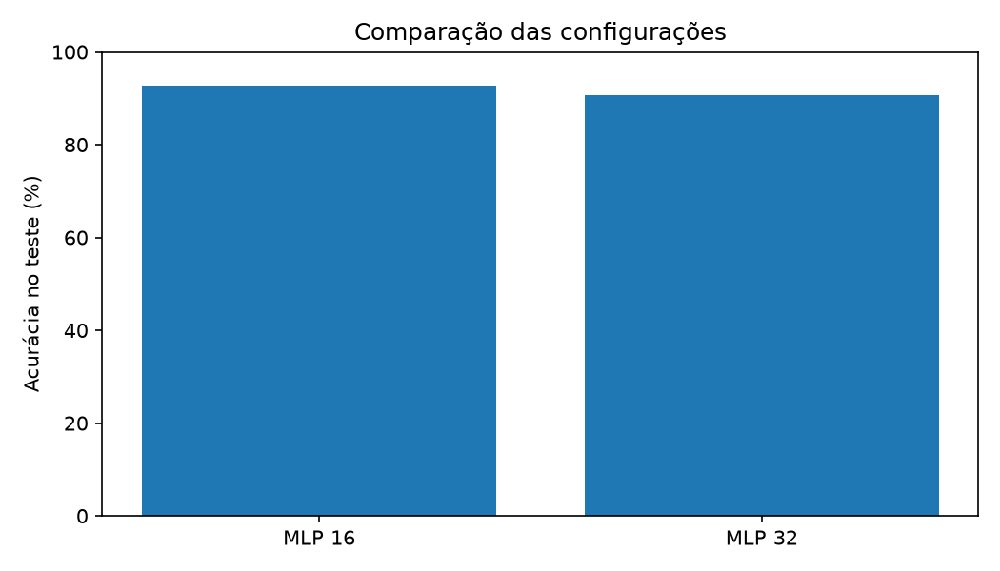
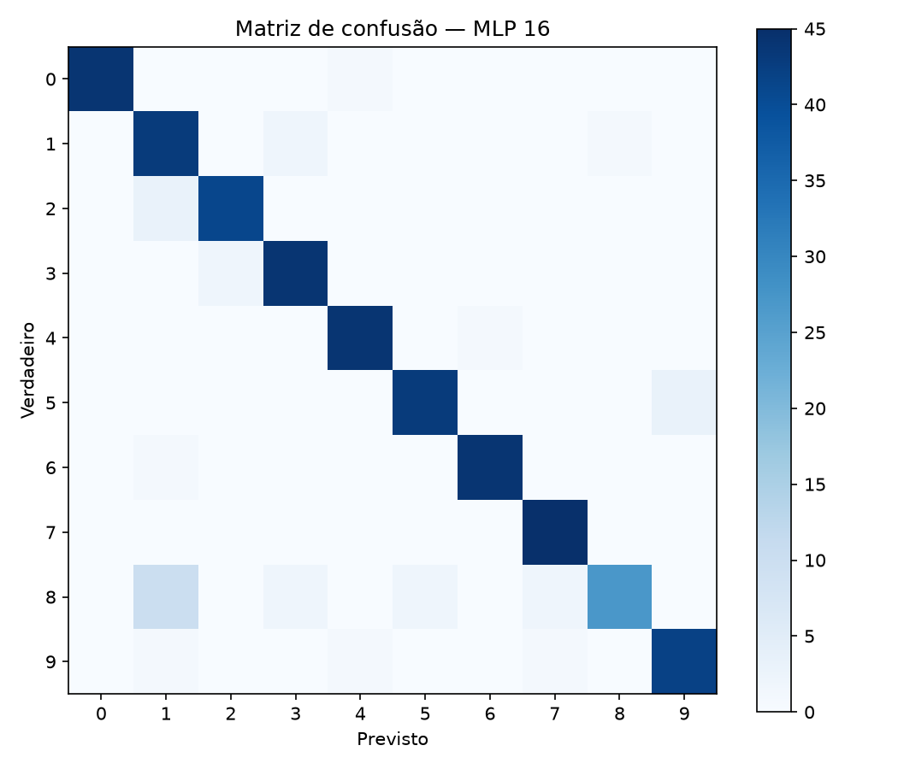
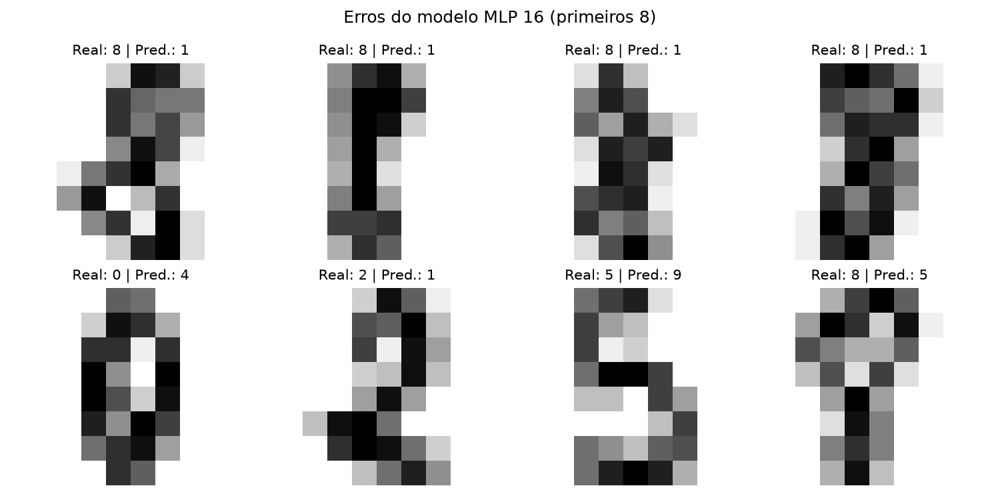

# Parecer técnico — Laboratório de Redes Neurais (MLP)

## Objetivo e metodologia
Comparar redes MLP com 16 e 32 neurônios ocultos para reconhecer dígitos manuscritos e realizar um experimento alterando **apenas** o tamanho da camada oculta de 32 para 64. Foi utilizado `load_digits` (1.797 imagens de 8 × 8 pixels), com 1.347 imagens no treinamento e 450 no teste, em divisão estratificada de 75%/25%, `random_state=42`. Para garantir comparação consistente, mantivemos `StandardScaler`, ativação ReLU, otimizador Adam e `max_iter=350`. O escalonamento foi ajustado exclusivamente com os dados de treinamento por meio de um pipeline.

## Comparação medida

| Configuração | Acurácia no teste | Acertos/450 | Erros | Parâmetros treináveis | Iterações | Tempo de treinamento* | Aviso de convergência |
|---|---:|---:|---:|---:|---:|---:|---|
| MLP (16,) | 97,11% | 437 | 13 | 1.210 | 285 | 0,3902 s | Não |
| MLP (32,) | 97,78% | 440 | 10 | 2.410 | 214 | 0,3523 s | Não |
| MLP (64,) — experimento | 98,00% | 441 | 9 | 4.810 | 164 | 0,3758 s | Não |

\*Tempos desta máquina e desta execução, não uma medida robusta de desempenho. Para comparar tempo de maneira confiável, seriam necessárias múltiplas execuções em ambiente controlado.

### Gráfico 1 — Comparação das redes de 16 e 32 neurônios

**Interpretação:** aumentar de 16 para 32 neurônios elevou a acurácia de 97,11% para 97,78% (três acertos a mais em 450 imagens), mas aumentou a quantidade de parâmetros de 1.210 para 2.410.

### Gráfico 2 — Matriz de confusão (32 neurônios)

**Interpretação:** a diagonal mostra os acertos por dígito; os valores fora da diagonal representam confusões entre dígitos. O modelo acertou 440 de 450 imagens e errou 10, indicando alto desempenho, mas não ausência de erros.

## Análise visual de erros (modelo com 32 neurônios)

### Gráfico 3 — Exemplos de dígitos mal classificados

O gráfico mostra os dígitos verdadeiros e os previstos pelo modelo; as imagens estão ampliadas para facilitar a inspeção dos traços.

1. **Imagem de índice 25 no teste — real 8, previsto 1:** o desenho é muito estreito; o contorno dos dois laços do 8 fica pouco evidente e há um traço central vertical forte, visualmente próximo de um 1.
2. **Imagem de índice 100 no teste — real 0, previsto 6:** o zero apresenta contorno lateral e fechamento inferior assimétricos, que podem lembrar a parte arredondada de um 6.
3. **Imagem de índice 229 no teste — real 7, previsto 4:** o traço superior e a descida irregular criam uma junção que pode lembrar um 4, sobretudo na resolução reduzida de 8 × 8 pixels.

Essas descrições são hipóteses visuais baseadas nos pixels mostrados em `resultados/erros.png`; **não comprovam a causa interna** das previsões do modelo.

## Alteração de um hiperparâmetro

No experimento adicional, alteramos somente `hidden_layer_sizes=(32,)` para `(64,)`. A acurácia passou de 97,78% a 98,00%, isto é, **apenas um acerto adicional** entre 450 exemplos, enquanto o número de parâmetros aumentou de 2.410 para 4.810. A redução de 10 para 9 erros no conjunto de teste não prova que 64 neurônios generalizem melhor em outras amostras.

### Gráfico 4 — Comparação após alterar para 64 neurônios

**Interpretação:** o ganho de 97,78% para 98,00% significa somente uma classificação correta adicional. Em contrapartida, a rede de 64 neurônios usa 4.810 parâmetros, contra 2.410 da rede de 32. Este resultado isolado não demonstra superioridade geral da rede maior.

### Gráfico 5 — Matriz de confusão após a alteração

A matriz da rede de 64 permite verificar quais dígitos ainda foram confundidos, em vez de avaliar somente a acurácia agregada.

### Gráfico 6 — Erros após a alteração

Os exemplos continuam mostrando que mesmo uma rede um pouco mais precisa pode errar dígitos de traçado difícil.

## Recomendação técnica

**Recomendamos, provisoriamente, a rede de 32 neurônios ocultos**, porque acertou 440 das 450 imagens (97,78%) com praticamente metade dos parâmetros da rede de 64 neurônios. Embora o modelo maior tenha alcançado 98,00%, a vantagem corresponde a apenas uma imagem neste teste. A rede de 16 neurônios é ainda mais simples, mas apresentou três acertos a menos que a de 32. Mais neurônios, portanto, **não garantem** melhores resultados: podem aumentar custo e risco de sobreajuste, sem ganho relevante. O experimento mostra apenas o desempenho dessas três configurações nesse conjunto, com esta separação e semente aleatória. Antes de produção, testaríamos outras sementes e validação cruzada, exemplos externos, diferentes caligrafias e condições de captura, desempenho por classe, latência, memória e critérios de segurança para revisão manual. Não houve aviso de convergência nesta execução.

## Evidências geradas

- `resultados/comparacao.png`: acurácia e parâmetros das redes de 16 e 32 neurônios.
- `resultados/matriz_confusao.png`: erros por dígito com 32 neurônios.
- `resultados/erros.png`: imagens mal classificadas pelo modelo com 32 neurônios.
- `resultados/comparacao_32_64.png`, `resultados/matriz_confusao_64.png` e `resultados/erros_64.png`: comparação e erros após o experimento.
- `resultados/metricas.json` e `resultados/comparacao.csv`: saídas estruturadas, regeneradas ao executar o script.

**Nota:** O arquivo original da atividade não foi disponibilizado; por isso, o script foi construído com base nas instruções recebidas, sem alegar equivalência exata com um código não fornecido.
